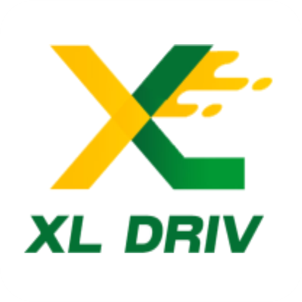

# XLDriv — Nigeria's Modern Fair Mobility & Logistics Platform

<div align="center">
  
  <br />
  <h3>Move On Your Terms.</h3>
  <p><strong>Set your fare, negotiate with drivers, and keep 100% of your earnings.</strong></p>

  [](https://react.dev/)
  [](https://www.typescriptlang.org/)
  [](https://vitejs.dev/)
  [](https://tailwindcss.com/)
  [](https://xldriv.com/)
  [](https://xldriv.com/)
</div>

---

## 📌 Executive Summary

**XLDriv** is a next-generation Nigerian mobility and logistics web platform engineered to break away from traditional high-commission aggregator models. Built with a people-first ethos and modern web standards, XLDriv empowers passengers to propose and negotiate their own fares, while offering driver-partners an industry-disrupting **0% commission** model powered by a flat daily subscription of **₦2,450**.

Beyond urban ride-hailing, XLDriv anchors a full-spectrum multimodal transport network spanning **City Rides**, **City-to-City (Interstate) trips**, **Ride-Sharing**, **Express Courier Deliveries**, and an industrial **Trucking & Port Customs Clearing** division based in Lagos.

---

## 🚀 Key Brand Propositions & Distinctive Features

### 1. 🤝 Propose Your Own Fare (Bid & Negotiation Model)
- Riders are never subject to rigid, algorithm-driven surge pricing.
- Riders set an initial price based on smart distance-based benchmarks and can increase or lower their offer.
- Nearby verified drivers receive the ride request and can either accept instantly or submit competitive counter-offers.

### 2. ⚡ Flat ₦2,450/Day Driver Model (0% Commission)
- Traditional ride-hailing platforms deduct 20% to 25% from every trip completed.
- XLDriv drivers keep **100% of every ride fare**.
- Drivers pay a flat subscription of **₦2,450 only on days they choose to drive**. If a driver rests, repairs their vehicle, or spends time with family, they pay **₦0**.
- Includes an interactive **Driver Monthly Profit Calculator** dynamically calculating tens of thousands of Naira in monthly savings.

### 3. 🌐 Multimodal Mobility & Industrial Fleet
| Service | Scope | Highlights |
| :--- | :--- | :--- |
| **City Rides** | Intra-city urban transport | Rapid pickups, climate-controlled comfort, transparent pricing. |
| **City-to-City** | Interstate long-distance | Door-to-door or terminal-to-terminal travel across Nigeria's major highway corridors. |
| **Ride-Sharing** | Carpooling & shared commutes | Book individual seats, split transport costs, and reduce road congestion. |
| **Express Courier** | Parcels & document dispatch | Same-day delivery across metropolitan areas with live parcel tracking. |
| **Haulage & Clearing** | Port & heavy industrial freight | Maritime clearance at Apapa and Tin Can ports, 40ft/20ft container transport, and interstate haulage. |

### 4. 🌙 Luxury Obsidian Dark Mode
- Built-in theme context (`ThemeContext.tsx`) with system preference detection and localStorage persistence.
- High-contrast, sleek obsidian palette (`bg-dark-950`, `border-dark-800`, `text-neutral-100`) with vibrant signature amber accents (`#F7B401`).
- Seamless toggle in the header navigation with smooth cross-transitions across all pages and modals.

### 5. 🛡️ Uncompromising Safety & Legal Compliance
- **Emergency In-App SOS**: Instant dispatch alerting 24/7 rapid response teams.
- **Live GPS Sharing**: Share journey tracking with trusted family and contacts.
- **Full Nigerian Legal Standing**: CAC Registered, NDPR (Nigeria Data Protection Regulation) compliant, dedicated Account & Data Deletion protocols.

---

## 🛠️ Technology Stack

- **Framework**: [React 19](https://react.dev/) + [TypeScript](https://www.typescriptlang.org/)
- **Build Tool**: [Vite 6](https://vitejs.dev/) with hot module replacement (HMR)
- **Styling**: [Tailwind CSS 3.4](https://tailwindcss.com/) with custom font configuration, dark mode tokens, and custom scrollbars
- **Icons**: [Lucide React](https://lucide.dev/) + optimized custom brand vector graphics
- **Routing**: [React Router v7](https://reactrouter.com/) (declarative multi-page routing)
- **Interactive UI**: [canvas-confetti](https://www.npmjs.com/package/canvas-confetti) for celebratory driver onboarding milestones

---

## 📂 Project Architecture

```
XL - DRIV/
├── public/
│   ├── favicon.png                # Official brand favicon & logo asset
│   └── images/                    # Preserved authentic fleet, vehicle & logistics photography
├── src/
│   ├── components/
│   │   ├── BookingCard.tsx        # Interactive fare proposal & route calculator card
│   │   ├── BookingModal.tsx       # Multi-step ride booking & driver bidding modal
│   │   ├── DriverCalculator.tsx   # Dynamic 0% commission monthly savings calculator
│   │   ├── DriverRegistrationModal.tsx # Driver application dialog with confetti trigger
│   │   ├── DriverSection.tsx      # Landing page driver recruitment & benefit showcase
│   │   ├── FaqSection.tsx         # Frequently Asked Questions accordion
│   │   ├── Footer.tsx             # Global footer with social links & legal directory
│   │   ├── Hero.tsx               # High-impact landing hero with animated micro-elements
│   │   ├── HowItWorksSection.tsx  # 4-step rider & driver workflow explanation
│   │   ├── Navbar.tsx             # Floating navbar with dark mode switch & hotline micro-bar
│   │   ├── ServicesSection.tsx    # 5-service portfolio carousel with direct booking hooks
│   │   └── WhyChooseUsSection.tsx # Trust badges, safety protocols, and company USPs
│   ├── context/
│   │   └── ThemeContext.tsx       # Dark / Light mode provider with persistent state
│   ├── data/
│   │   └── mobilityData.ts        # Centralized pricing, company metadata, FAQs, and routes
│   ├── pages/
│   │   ├── HomePage.tsx           # Primary flagship landing page
│   │   ├── ServicesPage.tsx       # Comprehensive service portfolio & customs quote RFP
│   │   ├── ForDriversPage.tsx     # Dedicated driver portal, requirements checklist & form
│   │   ├── AboutPage.tsx          # Corporate vision, mission, ethos, and leadership values
│   │   ├── ContactPage.tsx        # 24/7 support desk, contact form & interactive map
│   │   ├── TermsPage.tsx          # Terms of Use governed under Nigerian Law
│   │   ├── PrivacyPage.tsx        # NDPR-compliant privacy policy
│   │   ├── SafetyPage.tsx         # Safety guidelines, verification, and SOS documentation
│   │   ├── CookiesPage.tsx        # Web storage and cookie disclosure
│   │   └── DeleteAccountPage.tsx  # Compliant in-app & web data deletion request system
│   ├── App.tsx                    # Main root component with route definitions & modals
│   ├── index.css                  # Core CSS tokens, fonts, and dark mode base utilities
│   └── main.tsx                   # React DOM root entrypoint
├── index.html                     # HTML5 entry with SEO tags, OpenGraph & favicon
├── package.json                   # Project scripts and dependencies
├── tailwind.config.js             # Design tokens (brand colors, dark mode, display fonts)
├── tsconfig.json                  # TypeScript compiler settings
└── vite.config.ts                 # Vite bundle configuration
```

---

## ⚡ Quick Start & Development

### Prerequisites
- Node.js `v18.0.0` or higher
- npm `v9.0.0` or higher (or pnpm / yarn)

### 1. Installation
Clone the repository and install all dependencies:
```bash
git clone https://github.com/taiwoade-hub/XL-DRIV.git
cd XL-DRIV
npm install
```

### 2. Start Development Server
Run the local Vite development server:
```bash
npm run dev
```
Open your browser at `http://localhost:5173/` to view the application with live HMR.

### 3. Production Build
Compile the TypeScript code and generate optimized production assets:
```bash
npm run build
```
Preview the production build locally:
```bash
npm run preview
```

---

## 🚀 GitHub Pages & Custom Domain Deployment

This repository includes automated CI/CD deployment via GitHub Actions (`.github/workflows/deploy.yml`), client-side SPA routing fallback (`404.html`), `.nojekyll` bypass, search engine sitemap, and custom domain `CNAME`.

### 1. Enable GitHub Pages in Repository Settings
1. Go to your repository on GitHub: **[taiwoade-hub/XL-DRIV](https://github.com/taiwoade-hub/XL-DRIV)**.
2. Click **Settings** > **Pages** (in the left sidebar).
3. Under **Build and deployment** > **Source**, choose **GitHub Actions**.
4. Push your changes to the `main` branch. The action will automatically build and deploy the site!

### 2. Configure Custom Domain (`xldriv.com`)
1. In **Settings** > **Pages** > **Custom domain**, verify that `xldriv.com` is entered and click **Save**.
2. Check the box **Enforce HTTPS** once DNS resolution completes and certificate issues.
3. Configure your DNS provider (Namecheap, GoDaddy, Cloudflare, etc.) with GitHub Pages DNS records:
   - **Apex Domain (`xldriv.com`) A Records**:
     - `185.199.108.153`
     - `185.199.109.153`
     - `185.199.110.153`
     - `185.199.111.153`
   - **Subdomain (`www.xldriv.com`) CNAME Record**:
     - Host: `www`
     - Target / Value: `taiwoade-hub.github.io.`

---

## 🎨 Design System & Palette

- **Brand Gold / Amber**: `#F7B401` (`brand-500`) — Primary accent, active bids, highlights.
- **Deep Obsidian**: `#0a0a0a` (`dark-950`) — Dark mode canvas, typography headers.
- **Surface Dark**: `#171717` (`dark-900`) — Elevated cards, modals, and input fields in dark mode.
- **Pure White**: `#FFFFFF` — Light mode background and clean contrast.
- **Neutral Accent**: `#525252` (`neutral-600`) — Supporting editorial body text.
- **Success Emerald**: `#10B981` (`emerald-500`) — Active status, 0% commission badges, confirmed bookings.

---

## 🏢 Corporate Contact & Headquarters

- **Operating Entity**: XL-Driv Mobility Technologies Limited
- **Head Office**: 27, Raji Oba Street, Egbeda, Lagos State, Nigeria
- **Primary Support Hotline**: +234 913 827 2891 (09138272891)
- **Secondary Contact**: +234 706 814 8526
- **Email Inquiries**: [info@xldriv.com](mailto:info@xldriv.com) | [support@xldriv.com](mailto:support@xldriv.com)
- **Google Play Store**: [XLDriver & XLDriv on Android](https://play.google.com/store/apps)

---

## 📄 License

Copyright © 2025–2026 **XLDriv Mobility Technologies Limited**. All Rights Reserved.
Distributed under the Proprietary Commercial License for XLDriv Operations.
